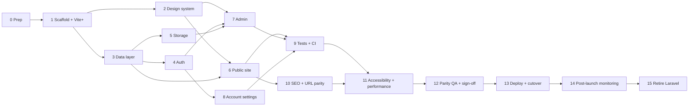

# Migration Plan: Laravel/Inertia/Svelte → Full-stack Astro

- **New project:** `~/projects/sic-landing-page-astro`, a separate directory with its own git repo.
- **Source project:** `~/projects/sic-landing-page` (Laravel). It is read-only for this migration and keeps serving production until cutover.
- Paths below are relative to the new project unless prefixed with `../sic-landing-page/`.

> **Revisions (2026-10-12), these override anything below:**
>
> - **Prisma 7 instead of Drizzle.** Provider is picked from `DATABASE_URL` (`file:` SQLite in dev, `mysql://`/`mariadb://`, `postgres://`). Edit `prisma/schema.base.prisma`; `scripts/prisma-schema.mjs` renders `prisma/schema.prisma`. Migrations live per provider in `prisma/migrations/<provider>/`.
> - **No cloud hosting.** No Cloud Run, Cloud SQL, `deploy-gcloud.sh` or deploy workflow. Uploads use `STORAGE_DRIVER`: `local` (default, `UPLOAD_DIR` on disk) or `s3` (any S3-compatible bucket via `S3_*`). Both are served at `/storage/<key>`; `S3_PUBLIC_URL` switches to direct bucket URLs.
> - **devenv.** `devenv up` runs the whole dev stack (install, schema, migrate, seed on first run, `astro dev`); `devenv test` runs everything CI runs. CI calls `devenv test`.
> - **SEO first.** Dynamic sitemap, robots, RSS, canonical/OG/Twitter tags and JSON-LD on every public page (Phase 10 moves ahead of admin work).
> - **Theme follows <https://sic.edu.ph>:** navy `#0A2E6E` / gold `#F59E0B`, Playfair Display (h1/h2) + Inter, sky background `#F2F7FE`. This replaces the Cormorant Garamond / DM Sans choice in §3.2 and the brand values in §3.1 (`src/styles/tokens.css` is the source of truth).
> - Phases 13–15 shrink to: build with `vp run build`, run `node dist/server/entry.mjs` on any Node 24 host with `DATABASE_URL` and the storage variables set, run `vp run db:deploy` before start.

## 1. Target stack

| Concern         | Today                                                                  | Target                                                                                                                 |
| --------------- | ---------------------------------------------------------------------- | ---------------------------------------------------------------------------------------------------------------------- |
| Framework       | Laravel 13 + Inertia v3                                                | Astro 7 (Vite 8), `output: 'server'`, `@astrojs/node` (standalone)                                                     |
| Toolchain       | npm, ESLint, Prettier, Vite via `laravel-vite-plugin`                  | **Vite+** (`vite-plus` 1.x, `vp` CLI): Node and pnpm management, Oxlint, Oxfmt, tsgolint, Vitest, Vite Task. See §2.   |
| UI              | Svelte 5 pages                                                         | `.astro` pages + reused Svelte 5 components as islands (`@astrojs/svelte`)                                             |
| Styling         | Tailwind v4, hard-coded hex colours, `amber-600/700` remapped to navy  | Tailwind v4 with a token layer (`src/styles/tokens.css`). See §3.                                                      |
| DB              | Eloquent; SQLite local, MySQL (Cloud SQL) prod, MariaDB in compose     | Prisma 7 with driver adapters; SQLite in dev, MySQL/MariaDB or PostgreSQL by `DATABASE_URL`                            |
| Auth            | Fortify (login, reset, email verification), session table              | Better Auth (email+password, reset, verification) with a custom bcrypt hasher                                          |
| Mutations       | `useForm` + `AdminController` (1099 lines)                             | Astro Actions (Zod validation) + one API route for inline image upload                                                 |
| Authorization   | Inline `abort(403)` in every method                                    | One `src/lib/server/authz.ts`: `requireUser`, `requireSuperAdmin`, `scopeDepartment`                                   |
| Files           | Hard-coded `public` disk, so uploads sit on Cloud Run's ephemeral disk | `src/lib/server/storage` with `STORAGE_DRIVER=local` (disk) or `s3` (S3-compatible bucket), served at `/storage/<key>` |
| Content         | Client-side regex parser `resources/js/lib/markdown.ts`                | Same parser, copied to `src/lib/markdown.ts`, rendered on the server in `.astro`                                       |
| Routing helpers | Wayfinder                                                              | Plain paths + `astro:actions`; generated `actions/`, `routes/`, `wayfinder/` are not copied                            |
| Tests           | Pest                                                                   | `vp test` (bundled Vitest 5; actions, authz, markdown, storage) + Playwright (smoke, SEO, a11y)                        |
| Static checks   | Pint, PHPStan, ESLint, Prettier, svelte-check                          | `vp check` (Oxfmt + Oxlint + type check), `astro check`, `svelte-check`, Prettier for `.astro` only                    |

**Rule:** keep every existing table and column name. Then the production database can be adopted in place, data needs no copy, and rollback to the Laravel revision stays possible until cutover is final.

## 2. Toolchain: Vite+

Sources: [viteplus.dev/guide](https://viteplus.dev/guide), [Run](https://viteplus.dev/guide/run), [Check](https://viteplus.dev/guide/check), [Test](https://viteplus.dev/guide/test), [CI](https://viteplus.dev/guide/ci), [Docker](https://viteplus.dev/guide/docker), [Oxfmt language support](https://oxc.rs/docs/guide/usage/formatter/language-support).

### Constraints that shape the setup

- **`vp dev` and `vp build` always run plain Vite, not Astro.** Astro has its own CLI, so dev and build go through tasks: `vp run dev` → `astro dev`, `vp run build` → `astro build`. The Vite+ docs use this exact Astro example.
- Vite+ needs Vite ≥ 8 and Vitest ≥ 4.1. Astro 7 depends on `vite ^8.3.1`, so this is met. The bundled Vitest is 5.x and needs Node `^22.18 || ^24.11 || >=26`. **Pin Node 24 in `.node-version`.**
- **Oxfmt does not format `.astro`** (it formats `.svelte` through bundled Prettier, with the `svelte` option enabled). Keep `prettier` + `prettier-plugin-astro` for `*.astro` only, and ignore `*.astro` in the Oxfmt config.
- **Oxlint lints only the script parts** of `.astro` (frontmatter + `<script>`) and `.svelte` (`<script>`). It does not lint template markup. Svelte rune globals (`$state`, `$props`, …) can trigger `no-undef`; disable that rule for `*.svelte`.
- `vp check` type-checks `.ts` only (tsgolint). Template types still need `astro check` (`.astro`) and `svelte-check` (`.svelte`). tsgolint does not support `compilerOptions.baseUrl`, so define the `@/*` alias with `paths` only.

### Config split

- `astro.config.mjs`: Astro, adapter, integrations, `vite.plugins` (Tailwind). This is what Astro's Vite uses.
- `vite.config.ts` (`defineConfig` from `vite-plus`): only the Vite+ blocks (`lint`, `fmt`, `test`, `staged`, `run.tasks`). It is never used to serve or build the app.

```ts
// vite.config.ts
import { defineConfig } from 'vite-plus';

export default defineConfig({
    lint: {
        options: { typeAware: true, typeCheck: true },
        overrides: [{ files: ['**/*.svelte'], rules: { 'no-undef': 'off' } }],
    },
    fmt: { svelte: true, ignorePatterns: ['**/*.astro'] },
    test: { include: ['src/**/*.test.ts'] },
    staged: {
        '*.{ts,js,svelte,css,json,md}': 'vp check --fix',
        '*.astro': 'prettier --write',
    },
    run: {
        tasks: {
            dev: { command: 'astro dev', cache: false },
            build: { command: 'astro build' },
            'check:templates': { command: 'astro check && svelte-check' },
            'fmt:astro': { command: 'prettier --check "src/**/*.astro"' },
            'db:generate': { command: 'drizzle-kit generate', cache: false },
            'db:migrate': { command: 'drizzle-kit migrate', cache: false },
            'db:seed': { command: 'tsx src/db/seed.ts', cache: false },
            e2e: { command: 'playwright test', dependsOn: ['build'], cache: false },
            ci: {
                command: 'vp check && vp run fmt:astro && vp run check:templates && vp test && vp run e2e',
                cache: false,
            },
        },
    },
});
```

Check the exact option names (`fmt.svelte`, `fmt.ignorePatterns`, `lint.overrides`) against the installed `vite-plus` during the Phase 1 spike.

### Daily commands

| Task                     | Command                                                                         |
| ------------------------ | ------------------------------------------------------------------------------- |
| Install Node + deps      | `vp install` (reads `.node-version`, uses pnpm)                                 |
| Add a dependency         | `vp add <pkg>` / `vp add -D <pkg>`                                              |
| Dev server               | `vp run dev`                                                                    |
| Format + lint + TS types | `vp check` (`--fix` to apply)                                                   |
| Template types           | `vp run check:templates`                                                        |
| Unit/integration tests   | `vp test` (`vp test watch`)                                                     |
| Production build         | `vp run build`                                                                  |
| E2E                      | `vp run e2e`                                                                    |
| Everything CI runs       | `vp run ci`                                                                     |
| Git hooks                | `vp config` once per clone (installs the hook dispatcher that runs `vp staged`) |

### Dependencies not carried over

`eslint` and all `eslint-*`/`@eslint/*`/`typescript-eslint`/`@stylistic/*` packages, `prettier-plugin-svelte`, `concurrently`, `laravel-vite-plugin`, `@laravel/vite-plugin-wayfinder`, `@inertiajs/*`, and a direct `vitest` (tests import from `vite-plus/test`).

## 3. Design plan

**Direction:** keep the current identity (navy header, Cormorant Garamond headings, DM Sans body, light/dark modes). Replace the ad-hoc colours and duplicated markup with a token system and one component per pattern, and fix accessibility gaps. This is not a rebrand. The design audit of the Laravel site found these problems:

- `amber-600/700` are overridden to navy in `app.css`, while `amber-300/400/500` stay gold. Light mode shows navy and dark mode shows gold for the same elements.
- Seven hex colours are hard-coded across pages (`#123573`, `#0f2d62`, `#FDFDFC`, `#1b1b18`, `#0a0a0a`, `#161615`, `#EDEDEC`).
- The shadcn tokens are greyscale, so admin primary buttons are black, not navy.
- Some classes have no effect: `prose*` (no typography plugin), `animate-fade-in` (no keyframes), `dark:text-neutral-350`, `text-neutral-550`.
- Markup is copied between pages: carousel ×2, post card ×3, type pill ×3, markdown section ×4.
- Footer link hover is navy on `#161615` in dark mode (contrast 1.4:1, invisible).

### 3.1 Colour tokens (`src/styles/tokens.css`)

Brand scale from the colours in use. Tailwind's `amber` stays untouched (no aliasing).

| Token                       | Light                   | Dark                      | Use                            |
| --------------------------- | ----------------------- | ------------------------- | ------------------------------ |
| `--brand-950`               | `#082456`               | same                      | pressed states                 |
| `--brand-900`               | `#0a2e6e`               | same                      | primary buttons, links (light) |
| `--brand-800`               | `#0f2d62`               | same                      | header border                  |
| `--brand-700`               | `#123573`               | same                      | header, dropdowns, mobile menu |
| `--gold-300` / `--gold-400` | `#fcd34d` / `#fbbf24`   | same                      | hover on navy, accents         |
| `--background`              | `#fdfdfc`               | `#0a0a0a`                 | page                           |
| `--surface`                 | `#ffffff`               | `#161615`                 | cards, footer, banners         |
| `--foreground`              | `#1b1b18`               | `#ededec`                 | body text                      |
| `--muted-foreground`        | `#737373` (neutral-500) | `#a3a3a3` (neutral-400)   | secondary text                 |
| `--primary`                 | `var(--brand-900)`      | `var(--gold-400)`         | buttons, links, active states  |
| `--primary-foreground`      | `#ffffff`               | `#0a0a0a`                 | text on primary                |
| `--border`                  | `rgb(0 0 0 / 0.05)`     | `rgb(255 255 255 / 0.05)` | cards                          |

- Dark-mode `--primary` is gold on purpose. This keeps today's dark look but makes it explicit, and navy on near-black fails contrast (1.4:1).
- Map the shadcn variables (`--primary`, `--ring`, `--sidebar-primary`, …) to these tokens so admin and auth pages use the brand colour too.
- Status tokens replace the three copied pill class sets:
    - Post types: article = green, event = blue, announcement = red.
    - File types: pdf = red, doc = blue, sheet = emerald, image = purple, archive = amber, other = neutral.
    - Each status token has a `-bg` and `-fg` pair for light and dark.

Measured contrast:

| Foreground on background                    | Ratio                                                                       |
| ------------------------------------------- | --------------------------------------------------------------------------- |
| White on `--brand-700` (header)             | 11.8:1                                                                      |
| `--gold-300` on `--brand-700` (nav hover)   | 8.2:1                                                                       |
| `--brand-900` on `--background`             | 12.7:1                                                                      |
| `--gold-400` on `--surface` (dark)          | 10.9:1                                                                      |
| `#737373` on white                          | 4.7:1                                                                       |
| `#a3a3a3` on white (current tags and dates) | 2.5:1 ✗, so `--muted-foreground` is never used on white below `neutral-500` |

### 3.2 Typography

- Self-host the fonts (`@fontsource-variable/dm-sans`, `@fontsource-variable/cormorant-garamond`) instead of the render-blocking Google Fonts `@import`. Preload the DM Sans latin subset.
- Serif (Cormorant Garamond) only for display: `h1`, `h2`, hero titles and the brand name. `h3` and below, card titles, labels and admin UI use DM Sans. Today every heading is serif, including 10–12 px org-chart names, which Cormorant's small x-height makes hard to read.
- Minimum text size is 12 px (`text-xs`). Remove the `text-[10px]`/`text-[11px]` uses.

| Role               | Classes                                                    |
| ------------------ | ---------------------------------------------------------- |
| Hero title         | `font-serif text-4xl md:text-6xl font-bold tracking-tight` |
| Page title (h1)    | `font-serif text-4xl md:text-5xl font-bold`                |
| Section title (h2) | `font-serif text-3xl md:text-4xl font-bold`                |
| Card title (h3)    | `font-sans text-lg font-semibold`                          |
| Body               | `font-sans text-base leading-relaxed`                      |
| Meta / eyebrow     | `font-sans text-xs font-semibold uppercase tracking-wider` |

- Markdown: keep the class-emitting approach of `markdown.ts` as the single styling source. Remove the inert `prose` wrappers, fix the invalid classes, wrap `<li>` runs in `<ul>`/`<ol>`, and shift content headings down one level (`#` → `h2`) so the page keeps a single `h1`.

### 3.3 Layout and spacing

- Container: `mx-auto max-w-7xl px-6`. Reading width: `max-w-3xl` (post detail) and `max-w-4xl` (markdown sections).
- Section rhythm: banners `py-12`, content sections `py-16 md:py-24`.
- Grids: cards `grid-cols-1 md:grid-cols-3 gap-8`, footer `md:grid-cols-4 gap-10`, contact `lg:grid-cols-2 gap-12`.
- Radius: cards `rounded-2xl`, inputs and buttons `rounded-xl`, chips `rounded-full`. The nav collapses below `md` (768 px).
- Hero heights: home `h-[500px] md:h-[600px]`, department `h-[400px] md:h-[450px]`. Images use `object-cover`. Admin crops carousel images at 16:9.

### 3.4 Component inventory

One implementation per pattern. Astro components render on the server with no JS. Svelte islands hydrate only where marked.

| Component                        | Kind                                     | Replaces                       | Notes                                                                                                                                                                                                                                                                             |
| -------------------------------- | ---------------------------------------- | ------------------------------ | --------------------------------------------------------------------------------------------------------------------------------------------------------------------------------------------------------------------------------------------------------------------------------- |
| `SiteHeader`                     | Astro + `NavMenu` island (`client:idle`) | `PublicLayout` header          | Dropdowns follow the disclosure pattern (button with `aria-expanded`, opens on click and Enter/Space, closes on Esc and outside click). Mobile toggle gets `aria-label`/`aria-expanded`. One loop over the nav data for desktop and mobile.                                       |
| `SiteFooter`                     | Astro                                    | footer block                   | Contact details as `tel:`/`mailto:` links. Privacy and Terms links per the Phase 0 decision.                                                                                                                                                                                      |
| `ThemeToggle`                    | island (`client:idle`)                   | toggle + `AppearanceTabs`      | Cookie plus an inline head script, so the page does not flash the wrong theme.                                                                                                                                                                                                    |
| `HeroCarousel`                   | island (`client:visible`)                | Welcome + Department carousels | Shared by home and department pages. Pauses on hover/focus with a visible pause button. No autoplay under `prefers-reduced-motion`. Hidden slides are `inert`. Controls only when there is more than one slide. Active dot uses `--gold-400`. The first slide renders without JS. |
| `PageBanner`                     | Astro                                    | 4 copied banners               | eyebrow, title, lead text                                                                                                                                                                                                                                                         |
| `MarkdownSection`                | Astro                                    | 4 copied blocks                | `set:html={parseMarkdown(...)}`                                                                                                                                                                                                                                                   |
| `PostCard`, `TypePill`           | Astro                                    | 3 copies                       | Variants `default` and `compact` (department page). Dates via one `formatDate(date, 'en-PH')`, so server and client output always match.                                                                                                                                          |
| `DepartmentCard`                 | Astro                                    | Welcome grid                   |                                                                                                                                                                                                                                                                                   |
| `OrgChart`                       | Astro                                    | hand-nested 3 levels           | Recursive and unlimited depth. Uses semantic `<ul>/<li>` with CSS connector lines (vertical + horizontal bus). DM Sans names, minimum 12 px.                                                                                                                                      |
| `FilterBar`                      | island                                   | Posts + Downloads filters      | Every input has a visible or `sr-only` label. Search is debounced 300 ms and updates the URL query. Type tabs use `aria-pressed`.                                                                                                                                                 |
| `DownloadBrowser`                | island (`client:load`)                   | Downloads page body            | The folder filter becomes a `?directory=` query param, so all filtering is server-side and every view has its own URL. The file card shows the extension text, not just colour. Icon-only buttons get `aria-label`.                                                               |
| `EmptyState`                     | Astro                                    | dashed boxes                   |                                                                                                                                                                                                                                                                                   |
| `ContactInfoCard`, `ContactForm` | Astro + island                           | Contact page                   | Form behaviour per the Phase 0 decision.                                                                                                                                                                                                                                          |
| Admin                            | existing shadcn `ui/*`                   | raw `<input>/<select>/<table>` | The port swaps hard-coded hex colours for tokens and replaces `confirm()` with the shadcn `Dialog`. Page layouts stay as they are.                                                                                                                                                |

### 3.5 Motion

- Keep it to colour transitions and hover lift on cards, plus the carousel crossfade (`transition-opacity duration-700`).
- Define a `fade-in` utility in `app.css` for the hero title, or remove its use.
- Every animation is disabled under `prefers-reduced-motion: reduce`.

### 3.6 Accessibility baseline (WCAG 2.2 AA)

- Skip link to `<main>`, one `h1` per page, landmark elements (`header`, `nav`, `main`, `footer`).
- Visible focus ring on every interactive element (`ring-2 ring-[--ring] ring-offset-2`), not a border colour change.
- Text contrast ≥ 4.5:1 and UI component contrast ≥ 3:1, using the §3.1 tokens.
- Decorative images get `alt=""` (post card images next to the title, logo next to the brand name). Content images (org-chart photos, post highlight) get meaningful alt text.
- `lang="en"` on `<html>`.

### 3.7 Imagery

- `../sic-landing-page/public/` has **no `images/` directory**. Every seeded `/images/*` path (3 department logos, 5 carousel images, 5 post images, 7 member photos) returns 404 today.
- `scope.md` forbids placeholder data, so real photos and logos from the college are a prerequisite (Phase 0).
- Sizes:
    - Carousel: 1920×1080 source, 16:9 crop.
    - Department logo: 512×512.
    - Member photo: 400×400, 1:1.
    - Post highlight: 1600×900.
- Serve through `astro:assets` `<Image>` with `widths` + `sizes`.

### 3.8 Design deliverables

- `src/styles/tokens.css` and `src/styles/app.css` (Tailwind `@theme` mapped to tokens).
- `src/pages/styleguide.astro`: every token, type role and component in both themes. It returns 404 unless `import.meta.env.DEV`.
- Playwright visual snapshots of the styleguide and each public page at 375, 768 and 1280 px, light and dark. They catch unintended visual changes after sign-off.

## 4. Phase dependencies



## 5. Phases

### Phase 0: Prep and decisions

- Install the global Vite+ CLI (`curl -fsSL https://vite.plus | bash`). It manages the machine-wide Node and package manager; `vp env off` opts out of that.
- `mkdir ~/projects/sic-landing-page-astro && git init` there, and create a new GitHub repo for it. The Laravel repo stays as it is and deployable until Phase 13.
- Take a production DB dump and a bucket/disk listing of `storage/app/public` from the running Cloud Run instance. Uploads may exist only on ephemeral disk, so recover them now or accept losing them.
- Request real imagery from the college (§3.7). This blocks seeding and the visual sign-off.
- Confirm parity decisions (default = keep current behaviour):
    - Email verification is **not enforced** today (`User` does not implement `MustVerifyEmail`, so the `verified` middleware is a no-op). Keep it off.
    - 2FA is not enabled in `config/fortify.php`. Do not port `SecurityController` 2FA paths or `TwoFactorAuthenticationRequest`.
    - Registration is disabled. Users are created only by a superadmin.
    - Rendered content is unsanitised `{@html}`. Keep this (admin-authored content), or add `sanitize-html` with an allow-list for the MDX-lite tags.
    - The contact form is fake: it shows "sent" and discards the message. Options are to send it via `sendMail` to `info@sic.edu.ph` (default), or remove the form and keep the contact cards.
    - Footer "Privacy Policy" and "Terms of Service" link to dead anchors. Remove them (default), or supply the page content.

### Phase 1: Scaffold and Vite+

- In `~/projects/sic-landing-page-astro`:
    - Write `.node-version` = `24`.
    - Run `vp dlx create-astro@latest .` (empty template, TypeScript strict), then `vp install`.
    - Add the stack: `vp add @astrojs/node @astrojs/svelte svelte @tailwindcss/vite tailwindcss drizzle-orm mysql2 better-auth bcryptjs @aws-sdk/client-s3 zod nodemailer`.
    - Add the UI deps from the Laravel `package.json`: `bits-ui clsx tailwind-merge tw-animate-css lucide-svelte svelte-sonner codemirror @codemirror/lang-markdown @codemirror/theme-one-dark cropperjs`, plus `@fontsource-variable/dm-sans @fontsource-variable/cormorant-garamond`.
    - Add dev deps: `vp add -D vite-plus drizzle-kit tsx @astrojs/check svelte-check typescript prettier prettier-plugin-astro @playwright/test @axe-core/playwright`.
- `vite.config.ts` as in §2. `package.json` keeps no `dev`/`build` scripts, because the tasks live in `vite.config.ts`. Run `vp config` to install hooks.
- `astro.config.mjs`:
    - `output: 'server'`, node adapter `mode: 'standalone'`, svelte integration, tailwind vite plugin.
    - `env.schema` (`astro:env`) for `DATABASE_URL`, `S3_*`, `MAIL_*`, `BETTER_AUTH_SECRET`, `PUBLIC_APP_NAME`.
- `tsconfig.json`: extend `astro/tsconfigs/strict`, `paths: { "@/*": ["./src/*"] }`, no `baseUrl`.
- Layout: `src/pages`, `src/layouts`, `src/components`, `src/lib`, `src/lib/server`, `src/actions`, `src/db`, `src/styles`.
- Copy from `../sic-landing-page`:
    - `resources/js/components/**` (including `ui/` shadcn-svelte) → `src/components`.
    - `resources/js/lib/{markdown,utils,theme.svelte,initials}.ts` → `src/lib`.
    - `resources/js/types` → `src/types`.
    - `components.json`, `.editorconfig`.
    - Static assets: `public/sic.png`, favicons, `robots.txt`.
- **Spike (before Phase 2):**
    1. `vp toolchain` shows Vite 8 and Vitest 5, and `vp run build` produces `dist/server/entry.mjs`.
    2. `vp check` passes on a `.astro` + `.svelte` + `.ts` sample. Oxlint parses frontmatter, and Svelte runes are not flagged.
    3. `vp test` runs a test that imports a module without `astro:*` imports.
    4. Whether `vp test` can resolve `astro:*` virtual modules through Astro's `getViteConfig()` inside the `test` block. If not, keep testable server code free of `astro:*` imports and pass config in as parameters.
- **Exit:** `vp run dev` serves a page with Tailwind and one hydrated Svelte component, and the four spike checks are recorded in the README.

### Phase 2: Design system

- Build §3.1–3.3 tokens, fonts and `app.css`. Map the shadcn variables to the tokens.
- Build the §3.4 components with the styleguide page (§3.8), driven by fixture data (not DB) so it can run in parallel with Phase 3.
- Fix `markdown.ts` (list wrapping, heading levels, invalid classes) with unit tests per MDX-lite tag.
- **Exit:** the styleguide renders every component in both themes. Axe reports no serious or critical issues on it, and the contrast pairs in §3.1 hold.

### Phase 3: Data layer

- Generate a starting schema with `drizzle-kit pull` against a DB migrated by `../sic-landing-page` (`php artisan migrate`), or against the prod dump from Phase 0. Then hand-edit `src/db/schema.ts`:
    - Tables: `users`, `departments`, `posts`, `carousel_items`, `members`, `navigation_links`, `downloads`, `download_directories`, `hero_sections`, `settings`.
    - Relations (Drizzle `relations()`): mirror the models. These are Department hasMany carouselItems/posts/members/downloads, Member and NavigationLink self-referencing parent/children, and Post/Download belongsTo department and user.
    - Casts: `downloads.tags` as JSON text (parse on read), booleans as `boolean()`, `posts.start_date/end_date` as `datetime`.
- Drop Laravel-only tables in a later migration: `cache`, `cache_locks`, `jobs`, `job_batches`, `failed_jobs`, `sessions`, `password_reset_tokens`. Better Auth replaces the last two.
- Baseline migration: mark the pulled schema as applied on existing DBs. New changes go through `vp run db:generate` / `vp run db:migrate`.
- Port `../sic-landing-page/database/seeders/{DatabaseSeeder,SettingSeeder,HeroSectionSeeder}.php` to `src/db/seed.ts` (`vp run db:seed`):
    - Data: nav links, 3 departments, 3 users, carousel items, posts, members, downloads with mock PDFs uploaded to the bucket, and the `welcome_hero_content` setting.
    - Use the real imagery from Phase 0 (§3.7).
    - Move seed passwords to env vars instead of committed literals.
- Query module `src/lib/server/queries.ts`, one function per `PublicController` method: `getNavLinks`, `getHomeData`, `getDepartmentPage(slug)`, `listDownloads({search, departmentId, directory})`, `listPosts({type, departmentId, search})`, `getPostBySlug`.
- **Exit:** seed runs against MariaDB from `compose.yaml`; query functions return the shapes the §3.4 components consume.

### Phase 4: Auth

- Better Auth with the Drizzle adapter (`provider: 'mysql'`), email+password enabled, `disableSignUp: true`.
    - Map the user model to the existing `users` table (`modelName`, `fields`). Keep numeric IDs, because posts and downloads FK `user_id`. Add `role` and `department_id` as `additionalFields`.
    - Password hashing: override `password.hash/verify` with `bcryptjs`. Existing Laravel hashes are `$2y$`, and bcryptjs verifies them.
    - Data migration script: create a `credential` account row for each existing user, holding their current `users.password` hash.
    - Password reset and verification emails go through a `sendMail` helper (SMTP via `nodemailer`). In dev it logs to the console, matching `MAIL_MAILER=log`.
    - Rate-limit sign-in to 5/min per email+IP, matching `FortifyServiceProvider`.
- `src/middleware.ts`: resolve the session, set `Astro.locals.user`, redirect unauthenticated `/dashboard`, `/admin/*`, `/settings/*` to `/login`.
- Pages: `/login`, `/forgot-password`, `/reset-password`, `/verify-email`, `/confirm-password`. Port the `auth/*.svelte` forms as islands and replace `<Form>`/Wayfinder with Better Auth client calls. Keep `AuthLayout`, restyled through the tokens.
- **Exit:** the seeded superadmin logs in with the existing password hash; reset email flow works end-to-end in dev.

### Phase 5: Storage

- `src/lib/server/storage.ts`: `put(prefix, file) → key`, `remove(key)`, `publicUrl(key)`. Buckets are public-read, as `scope.md` requires.
- Normalise paths: the DB currently stores `/storage/<path>` for images but a bare `<path>` for `downloads.file_path`. Store bare keys everywhere and build URLs with `publicUrl`. Rewrite existing rows in the data migration script.
- Copy recovered files from Phase 0 into the bucket under the same keys (`posts/`, `posts/inline/`, `downloads/`, `carousels/`, `departments/`, `members/`).
- Size limits from the current validators: images 5 MB (members 2 MB), downloads 20 MB. Set Node adapter body limits to match.
- **Exit:** upload, delete and public URL work against MinIO.

### Phase 6: Public site

| Laravel route             | Astro page                           | Notes                                                                                                                                                         |
| ------------------------- | ------------------------------------ | ------------------------------------------------------------------------------------------------------------------------------------------------------------- |
| `GET /`                   | `src/pages/index.astro`              | carousel (`show_on_main`), departments, latest posts, welcome hero, global hero sections. `featuredPosts` is loaded but never rendered today; drop the query. |
| `GET /departments/{slug}` | `src/pages/departments/[slug].astro` | carousel, posts, org chart (recursive), hero sections                                                                                                         |
| `GET /downloads`          | `src/pages/downloads.astro`          | `?search=&department_id=&directory=`                                                                                                                          |
| `GET /posts`              | `src/pages/posts/index.astro`        | `?type=&department_id=&search=&sort=`                                                                                                                         |
| `GET /posts/{slug}`       | `src/pages/posts/[slug].astro`       | 404 when missing                                                                                                                                              |
| `GET /contact`            | `src/pages/contact.astro`            | contact cards + form per Phase 0 decision                                                                                                                     |

- `src/layouts/PublicLayout.astro` = `SiteHeader` + `<main id="main">` + `SiteFooter` + skip link. Pages compose only §3.4 components.
- Replace `router.get` filter calls with URL query updates through `FilterBar`. Replace `Link` with `<a>`.
- Render markdown on the server: `set:html={parseMarkdown(content)}`. The admin editor preview imports the same module.
- `<title>`/meta per page through layout props.
- **Exit:** each page shows the same content as the Laravel site on the same DB and matches the §3 spec. Visual differences from Laravel are intentional.

### Phase 7: Admin

- Pages under `src/pages/admin/**` and `src/pages/dashboard.astro` use `AppLayout` (sidebar, header, breadcrumbs) converted to `.astro` shells. Sidebar/dropdown stay Svelte islands, and the sidebar state cookie is read in the layout.
- One action module per resource in `src/actions/` (`posts`, `downloads`, `directories`, `navlinks`, `departments`, `members`, `carousels`, `users`, `heroSections`, `settings`), with Zod schemas copied from the current validators.
- Authorization in `authz.ts`, called first in every action and page:
    - `requireSuperAdmin`: navlinks, users, landing settings, department create/delete.
    - `scopeDepartment(user, row)`: department users can only read/write their own `department_id`, and it is forced on create.
- Port business rules exactly:
    - Post slug: `slugify(slug ?? title)`, empty becomes `post`, append `-1`, `-2`, … until unique.
    - Department slug from name, unchanged on update. **Fix:** add the same collision suffixing.
    - Downloads: tags split by comma and trimmed; directory defaults to `General`; `file_size` recorded; create/delete only.
    - Deleting a replaced or removed image deletes the stored object.
- Forms: keep the existing Svelte create/edit pages as islands, and swap `useForm` for `actions.x(formData)` with field errors and a `processing` state. Flash toasts: put the message in `Astro.session` and read it in the layout for `svelte-sonner`.
- Styling per §3.4 (admin row): replace hard-coded hex colours with tokens and `confirm()` with the shadcn `Dialog`.
- Inline image upload: `POST /api/admin/uploads/image` (JSON `{url}`). Update the `fetch` in `MarkdownEditor.svelte` and drop the CSRF header (Astro `security.checkOrigin`).
- Reuse `MarkdownEditor`, `ImageCropper`, `ImageCropperModal` and `components/ui/*` apart from imports and tokens.
- **Fix during port** (current bugs):
    - `DELETE /admin/users/{id}` has no route, but `users/Index.svelte` calls it. Implement `actions.users.delete`.
    - `POST /admin/posts/upload-image` is declared after `POST /admin/posts/{post}` and is shadowed by it. The new API path removes the conflict.
    - Member `parent_id` is not checked to belong to the same department. Validate it.
- **Exit:** every admin screen performs its CRUD as superadmin and as a department user, and cross-department access returns 403.

### Phase 8: Account settings

- `/settings/profile`: name/email update, delete account with password confirmation.
- `/settings/security`: password change, re-auth required.
- `/settings/appearance`: uses the shared `ThemeToggle` (cookie) and replaces `HandleAppearance`.
- **Exit:** parity with `tests/Feature/Settings/*` behaviour.

### Phase 9: Tests and CI

- `vp test` integration tests against a MariaDB service container, porting the intent of the Pest suite (tests import from `vite-plus/test`):
    - Public pages return 200 with seeded data (`PublicPagesTest`, `ExampleTest`).
    - Guests are redirected from `/dashboard` and `/admin/*`; authenticated access works (`DashboardTest`, `AdminPagesTest`).
    - Auth: login, invalid password, logout, rate limit, password reset, password confirmation.
    - Settings: profile update, email unchanged, delete account, wrong password, password update.
    - **New:** department scoping (403 on another department's post/download/member), superadmin-only actions, slug collision suffixing, upload/delete removes objects. None of this is covered today.
- `vp test` unit tests for `parseMarkdown` (each MDX-lite tag: `Card`, `Center`, `Accordion`, `Badges`, `Flex`; list wrapping; heading shift).
- Playwright (`vp run e2e`):
    - Smoke: home → department → post; admin login → create post with an inline image → visible on `/posts`.
    - Visual snapshots per §3.8.
- `.github/workflows/ci.yml` in the new repo:
    - Job steps: `voidzero-dev/setup-vp@<exact version>` (`node-version: '24'`, `cache: true`; never the `v1` tag), MariaDB + MinIO services, `vp exec playwright install --with-deps chromium`, `vp run ci`.
    - Add the Vite Task GitHub Actions cache.
    - Add a `github-actions` entry to `.github/dependabot.yml` so the pinned `setup-vp` version gets updates.
- **Exit:** CI is green.

### Phase 10: SEO and URL parity

- Public URLs stay the same (`/`, `/departments/{slug}`, `/downloads`, `/posts`, `/posts/{slug}`, `/contact`), so page routes need no redirects.
- Legacy file URLs: post and hero content contains inline images as `/storage/posts/inline/...`. Either rewrite those URLs in the content during the data migration script, or add a `/storage/[...path]` route that 301s to `publicUrl(path)`. Do both, so that external links to files also keep working.
- Add `@astrojs/sitemap` (public pages plus every post and department slug from the DB) and update `robots.txt` to point at it and disallow `/admin`, `/dashboard`, `/settings`, `/styleguide`.
- Per-page `<title>`, meta description, canonical URL and Open Graph tags. Posts use `highlight_image_path` as the OG image.
- Custom `404.astro` and `500.astro` in `PublicLayout`.
- **Exit:** a crawl of the Laravel site's URL list (pages + `/storage/*` links found in content) against staging returns 200 or a 301 to a 200.

### Phase 11: Accessibility and performance

- Run `@axe-core/playwright` in the Phase 9 specs on every public page and the admin forms. Fail CI on serious or critical violations. Manual keyboard-only pass over the header, dropdowns, carousel, filters and admin forms against §3.6.
- Lighthouse CI on `/`, a department page and a post page, with budgets: performance ≥ 90, accessibility ≥ 95, SEO ≥ 95.
- Hydrate only the islands listed in §3.4. Public pages must not ship the admin UI bundle.
- Images: allow the bucket host in `image.remotePatterns` and serve carousel, post and member images through `astro:assets` `<Image>` (§3.7).
- Cache headers: public pages `Cache-Control: public, max-age=60, stale-while-revalidate=600`. Admin, auth and settings responses `no-store`.
- **Exit:** budgets pass in CI.

### Phase 12: Parity QA and sign-off

- Run Laravel (`../sic-landing-page`) and Astro side by side against the same staging DB copy. Compare each public page and admin screen for content and behaviour with a written checklist (one row per route and per admin action). Layout and colour are judged against §3, not against Laravel.
- Design review: the site owner approves the styleguide and the visual snapshots in light and dark.
- UAT: the superadmin and at least one department user from each department run their usual tasks on staging. Tasks include creating a post with an inline image, uploading a download into a directory, editing the org chart, and reordering carousel items.
- Log every difference as fix-now or accepted-change. Intentional changes are the §3 design changes, the Phase 7 bug fixes and the Phase 0 decisions.
- **Exit:** written sign-off from the site owner. No open fix-now items. Visual snapshots updated and locked.

### Phase 13: Deploy and cutover

- `Dockerfile` (new), following the Vite+ Docker guide:
    - Build stage `ghcr.io/voidzero-dev/vite-plus:<exact tag>`: `vp install --frozen-lockfile`, `vp run build`, copy the resolved Node binary.
    - Separate `deps` stage: `vp install --frozen-lockfile --prod`.
    - Runtime `debian:bookworm-slim` with that Node binary, `dist/`, prod `node_modules` and `package.json`. `ENV HOST=0.0.0.0 PORT=8080`, `CMD ["node", "dist/server/entry.mjs"]`.
    - Migrations run as a Cloud Run job (`vp run db:migrate` in the build image).
- `compose.yaml` (new, single file): app + `mariadb:11` + MinIO, based on `../sic-landing-page/compose.yaml`. Drop Redis and the committed `APP_KEY`. Do not carry over the duplicate `docker-compose.yml`.
- `deploy-gcloud.sh` (adapted from the Laravel copy): keep Cloud Run + Cloud SQL + GCS and the same Cloud Run service name, so cutover is a new revision. Swap env vars to the Astro set and change the migrate job from `artisan migrate` to the Drizzle migrate command.
- `.github/workflows/deploy.yml` (new): call `./deploy-gcloud.sh` with env names matching the script (`PROJECT_ID`/`REGION`). The Laravel version calls the missing `deploy-gcp.sh` and uses mismatched names, so do not copy it as is. Copy the GCP secrets (`GCP_SA_KEY`, DB credentials) into the new GitHub repo.
- Rehearse on a staging Cloud Run service with a copy of the prod DB: run the data migration script (Better Auth account rows, path normalisation, content URL rewrite), then the full Playwright suite. Do not drop Laravel tables yet.
- Cutover:
    1. Disable `.github/workflows/deploy.yml` in `../sic-landing-page`, so a push there cannot redeploy Laravel over Astro.
    2. Put Laravel in maintenance mode.
    3. Take a final DB dump and file sync.
    4. Run the data migration script on prod.
    5. Deploy the new revision and shift traffic.
- Rollback: restore the pre-cutover DB dump and route traffic back to the Laravel revision. Content written on Astro after cutover is lost. A plain traffic switch is not enough, because the migration rewrites file paths and post content to the new bucket URLs, and Laravel cannot read them.

### Phase 14: Post-launch monitoring

- Stabilisation window: 1 week after cutover.
- Cloud Run log-based alerts on 5xx rate and latency. Cloud Monitoring uptime check on `/` and `/posts`. Error tracking (e.g. Sentry for Astro) on server and client.
- Watch daily: failed logins, upload errors, 404s under `/storage/*` (missed file migrations).
- Rollback trigger: sustained 5xx or a broken admin write path that cannot be hot-fixed within a day.
- At the end of the window: run the Drizzle migration that drops `cache`, `cache_locks`, `jobs`, `job_batches`, `failed_jobs`, `sessions`, `password_reset_tokens`, and delete the Laravel Cloud Run revision and image. After this, rolling back to Laravel is no longer possible.
- **Exit:** a week with no rollback trigger. Laravel tables dropped.

### Phase 15: Retire Laravel

- Archive the Laravel GitHub repo (read-only). Keep `~/projects/sic-landing-page` locally for reference, or delete it once nothing points at it.
- Write `AGENTS.md` for the new repo covering the Astro stack, the `vp` commands in §2 and the design rules in §3. Do not copy the Laravel Boost guidelines.

## 6. Risks

| Risk                                                                            | Mitigation                                                                                                                                  |
| ------------------------------------------------------------------------------- | ------------------------------------------------------------------------------------------------------------------------------------------- |
| Uploaded files exist only on the ephemeral Cloud Run disk                       | Recover in Phase 0. Move to the bucket in Phase 5.                                                                                          |
| Vite+ is new (1.x) and Astro drives its own Vite                                | Use Vite+ for install/check/test/tasks only; Astro owns dev/build. Phase 1 spike validates this before anything is built on it.             |
| Oxfmt cannot format `.astro`; Oxlint skips template markup                      | Prettier for `.astro`; `astro check` + `svelte-check` for templates; axe in Playwright covers markup accessibility.                         |
| `vp test` may not resolve `astro:*` virtual modules                             | Phase 1 spike. Fallback: keep tested server code free of `astro:*` imports.                                                                 |
| No real imagery exists for seeds and design sign-off                            | Request in Phase 0. It blocks Phase 3 seeding and Phase 12 sign-off.                                                                        |
| Better Auth's user/account model differs from Laravel's single `users.password` | Field mapping + `credential` account rows + bcrypt verify; test with a real prod hash in staging.                                           |
| Numeric user IDs vs Better Auth defaults                                        | Configure numeric ID generation. Check this in Phase 4 before building on it.                                                               |
| Unsanitised HTML in content                                                     | Explicit decision in Phase 0.                                                                                                               |
| Behaviour drift in 1099-line `AdminController`                                  | Port resource by resource with tests in Phase 9 before cutover.                                                                             |
| Design changes read as regressions in UAT                                       | Owner approves the styleguide in Phase 2 and the snapshots in Phase 12. Parity QA judges layout against §3.                                 |
| Rollback after cutover loses new content                                        | Keep the window short (Phase 14). Rollback restores the pre-cutover dump. Drop Laravel tables and the revision only at the end of Phase 14. |

## 7. Definition of done

- All routes in the Phase 6 table and every `/admin/*` screen work on Astro with the existing production data.
- Public and admin pages implement the §3 design: tokens only (no hard-coded hex), one component per pattern, §3.6 baseline met, owner-approved snapshots.
- Existing users log in with unchanged passwords.
- All uploads are served from the bucket.
- `vp run ci` (check, template check, tests, e2e, a11y, visual) is green, and deploy runs from `main` of the new repo.
- The Laravel repo is archived and its deploy workflow disabled.
